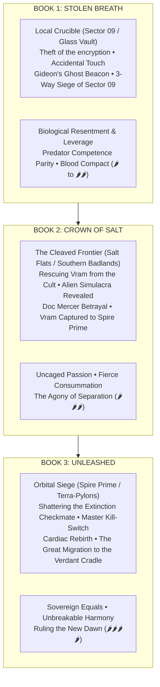

# The Arkun Cycle: Master Trilogy Architecture

**Author:** J.D. Alfaro  
> **Genre:** Biopunk Romantasy / High-Stakes Sci-Fi  
> **Timeline:** Year 40 AS (forty years After the Storm)  
> **Protagonists:** **Dr. Tsunari Thorne** ("Tsune" / "Tsunie") & **Commander Vram Tyage** ("Vram" / "Pyre-Zero")  
> **Format:** Three Full-Length Novels | Dual POV (First-Person or Third-Person Limited Alternating)

---

## 1. Executive Trilogy Vision & Themes

*   **Theme 1: Autonomy vs. Conditioning & Fanaticism:** The struggle of engineered weapons (Vram, chimeric soldiers) and hunted survivors (Tsunari, Gray Sector) to reclaim their minds, identities, and bodies—refusing both corporate enslavement (Apex Bio) and apocalyptic cult deification (The Enlightened / The Forger).
*   **Theme 2: The Fire & Shadow Polarity:** An intimate biopunk symbiosis. Vram's Avian furnace brings warmth and the wing. Tsunari's cool Raptor body takes that heat on contact. Her Null-Resonance, aimed, quiets one leash. The cool and the quiet are two events.
*   **Theme 3: The Subversion of Romance Clichés:** The bond progresses from biological shame, humiliation, and hostage leverage to earned predator competence parity, the psychological terror of mental silence, and an unvoiced blood compact of equals.
*   **Theme 4: The Reconstruction of Truth & The Promised Land:** Moving from the localized lies of Sector 09 to the global conspiracy of the alien *Simulacra*, shattering the Karyon's existential blackmail through the discovery of **The Verdant Cradle** (the hidden, un-poisoned green oasis continent across the Stygian Oceans), culminating in the Great Oceanic Migration.

---

## 2. The three books

* *Stolen Breath*: the story is `stolen_breath/plot.md`. The division and the chapters are `stolen_breath/breakdown.md`.
* *Crown of Salt*: the story is `crown_of_salt/plot.md`. The division and the chapters are `crown_of_salt/breakdown.md`.
* *Unleashed*: the story is `unleashed/plot.md`. The division and the chapters are `unleashed/breakdown.md`.

Book 1 may aim at a later payoff. It does not finish it. The Cradle, the beacon, and the migration stay in `canon/world/cradle.md`.

## 3. The 3-Book Romance Heat & Trajectory

| Phase | Book 1: *Stolen Breath* | Book 2: *Crown of Salt* | Book 3: *Unleashed* |
| :--- | :--- | :--- | :--- |
| **Romantic Dynamic** | Biological Resentment $\rightarrow$ Competence Parity $\rightarrow$ Terror of Silence $\rightarrow$ Blood Compact | Uncaged Devotion & Passion Tested by Extraterrestrial Betrayal | Sovereign Equals / Unbreakable Union |
| **Heat Level** | 🌶️ to 🌶️🌶️ (Tension, Fever Triage, Near-Kiss) | 🌶️🌶️🌶️ (Geothermal Haven Consummation) | 🌶️🌶️🌶️🌶️ (Touch-Starved Reunion & Sovereign Surrender) |
| **Key Tropes** | Accidental Shock, Humiliating Dependency, Hostage Leverage, "Who Did This To You?", Sovereign Refusal | Bed Sharing on the Run, Fierce Consummation, Forced Separation, Desperate Sacrifice | The Grand Orbital Rescue, Touch-Starved Reunion, Battle Couple |
| **Naming Milestones** | "The Captive / Anomaly" $\rightarrow$ "Thorne" $\rightarrow$ "Tsune" / Unvoiced Compact | "Tsune" & "Ty" in combat $\rightarrow$ Whispered *"Tsunie"* in raw intimacy | Unshakeable mutual devotion $\rightarrow$ Two halves of one soul |

---

## 4. Character Evolution Across the Trilogy

### Dr. Tsunari Thorne ("Tsune" / "Tsunie")
*   **Book 1:** A solitary, calculating survivalist who trusts only kinetic speed and cold odds. Learns that relying on a radiant, protective counterweight makes her a formidable, sovereign leader. Rejects both corporate propaganda and cult demagoguery.
*   **Book 2:** A tactical commander grappling with the shattering betrayal of her surrogate father (Doc Mercer). Transforms grief into unyielding, lethal resolve.
*   **Book 3:** A legendary revolutionary who masters her Quantic Phase-Stutter at scale, leading an orbital assault to rescue the man she loves and liberate humanity.

### Commander Vram Tyage ("Vram" / "Pyre-Zero")
*   **Book 1:** A leashed corporate executioner living in blinding neuro-pain. Discovers through Tsunari’s touch that he is a human being with a soul. Rejects The Forger's false messianic throne and Elena Corvus's leash, choosing autonomous partnership beside Tsunari.
*   **Book 2:** A protective, deeply devoted partner whose feral protectiveness is pushed to the limit. Sacrifices his own freedom so she can live.
*   **Book 3:** Endures torture in the orbital spires without breaking. The cardiac shock restarts him once the leash is cut. He comes out of that room free, and spent.

### Aeros-Legion 7 (Cassian, Veda, Ferrin Calder, Toby Vance) & Allies (Boran, Madame Chen, Kira)
*   **Book 1:** Suspicious, conditioned soldiers following orders out of fear. Joined by undercity allies (Boran, Madame Chen, Kira Brandt), they choose Vram and defect after experiencing neural clarity from Tsunari's prototype stabilizer.
*   **Book 2:** Operating as a mobile guerilla strike force across the global wasteland; confronting the reality of their chimeric origins and battling corporate purge teams.
*   **Book 3:** The frontline vanguard leading the assault on the orbital spires, awakening thousands of fellow chimeric soldiers worldwide.
